# Pruebas Unitarias 

> Plantilla editable transcrita de `casos-de-prueba-neque.pdf` (4 de noviembre de 2026). 

**Alcance:** Regresión funcional · 67 casos · Prioridad alta: 28 · Media: 33 · Baja: 6.

## Antes de empezar

1. Prueba en el iPhone con la última IPA y en Safari móvil a 375 px y 320 px, en modo claro y oscuro.
2. Usa las cuentas de prueba del equipo: un entrenador y dos alumnos asignados a rutinas distintas. Nunca cuentas reales.
3. Si un caso falla, anota qué viste, el dispositivo y la hora para buscarlo en los logs.
4. Prioriza los casos de prioridad alta.

## Credenciales de prueba

### Entrenador: 
	Email : entrenador@neque.cl
	Contraseña: 1232026*Cl
### Alumno: 
	Email: alumno@neque.cl
	Contraseña: 1232026*Cl
## Datos de la ejecución

- **Versión / build / IPA:** <!-- Completar -->
- **Entorno / URL:** <!-- Completar -->
- **Responsable:** <!-- Completar -->
- **Fecha:** <!-- Completar -->

## Módulos

| Código | Módulo | Casos |
| --- | --- | ---: |
| ACC | Acceso y sesión | 8 |
| INV | Invitaciones | 5 |
| ALU | Alumnos y ficha | 7 |
| RUT | Rutinas y ejercicios | 11 |
| ENT | Entrenamiento del alumno | 7 |
| AGE | Agenda y citas | 7 |
| MSJ | Mensajes | 5 |
| PRG | Progreso | 5 |
| NOT | Notificaciones | 1 |
| PER | Perfil y preferencias | 3 |
| UX | Interfaz y accesibilidad | 4 |
| SEG | Seguridad y privacidad | 4 |

## Cómo completar la plantilla

Marca un solo estado por caso después de ejecutarlo. Deja las casillas vacías mientras esté pendiente. Completa el resultado obtenido y agrega evidencia o notas cuando corresponda. Los pasos y resultados esperados se conservan del documento original.

## ACC - Acceso y sesión

### ACC-01 - Inicio de sesión correcto según el rol

- **Rol:** Ambos
- **Prioridad:** Alta

**Precondición:** Cuenta de entrenador y de alumno activas.

**Pasos:**

1. Abrir la app y tocar Ingresar.
2. Iniciar sesión con la cuenta de entrenador.
3. Cerrar sesión e iniciar con la de alumno.

**Resultado esperado:** El entrenador llega al Inicio del entrenador y el alumno al Inicio del alumno. Cada uno ve solo las pestañas de su rol.

**Estado:**

- [x] Pasa
- [ ] Falla
- [ ] Bloqueado

| Campo                         | Completar                 |
| ----------------------------- | ------------------------- |
| Probó                         | Benjamín Hidalgo          |
| Fecha                         | 06-11-26                  |
| Hora                          | 22:34                     |
| Dispositivo                   | iPhone - Navegador Safari |
| Sistema operativo / navegador | IOS - Safari              |
| Versión / build               |                           |

**Resultado obtenido:** Se logra iniciar sesión correctamente con los roles correspondientes.

**Evidencia:** 
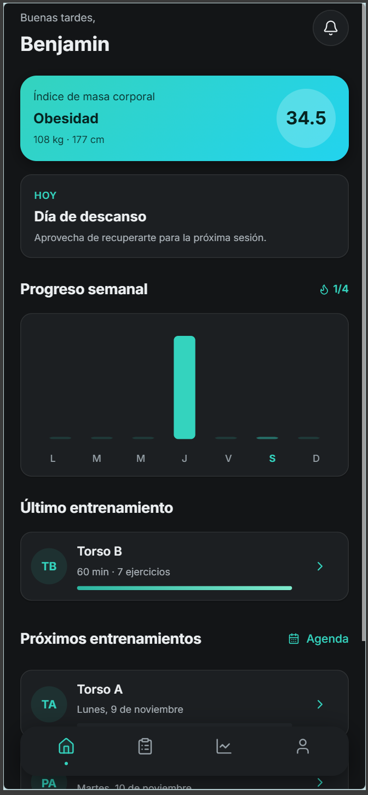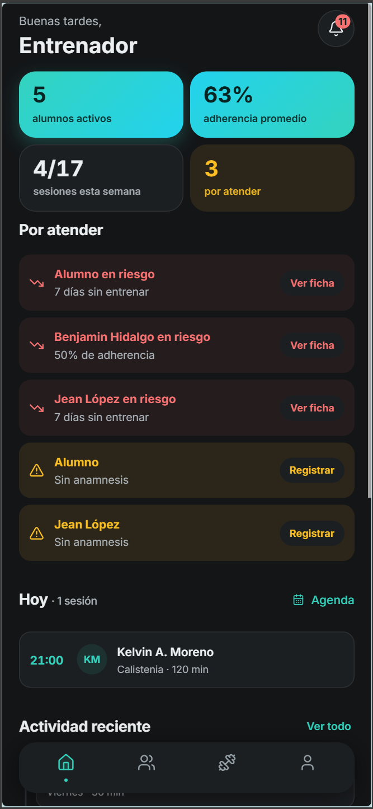

**Nota / incidencia:** Las guías de contraseña deberían aparecer solo al momento de crear la contraseña, no tienen sentido en el login. 
Tampoco le veo sentido el hecho de que no te deje ingresar si la contraseña no cumple con los parametros **para crearla**. 
Debería dejarme clickar y que me aparezca el mensaje de contrasñe

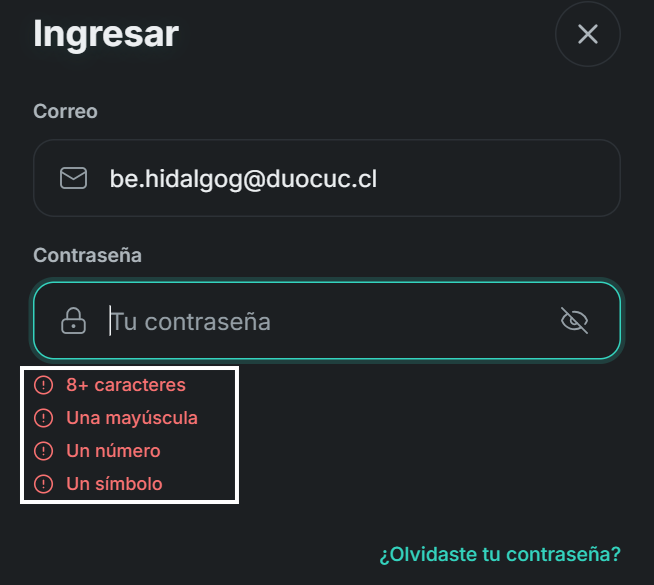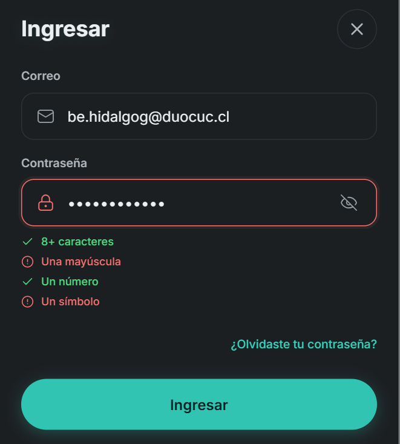

---

### ACC-02 - Credenciales incorrectas

- **Rol:** Ambos
- **Prioridad:** Alta

**Precondición:** Cuenta activa.

**Pasos:**

1. Ingresar el correo correcto y una contraseña equivocada.

**Resultado esperado:** Aparece «Correo o contraseña incorrectos.» sin revelar si el correo existe. La app no se cuelga.

**Estado:**

- [x] Pasa
- [ ] Falla
- [ ] Bloqueado

| Campo                         | Completar                 |
| ----------------------------- | ------------------------- |
| Probó                         | Benjamín Hidalgo          |
| Fecha                         | 06-11-26                  |
| Hora                          | 22:34                     |
| Dispositivo                   | iPhone - Navegador Safari |
| Sistema operativo / navegador | IOS - Safari              |
| Versión / build               |                           |

**Resultado obtenido:** Muestra correctamente "Correo o contraseña incorrectos"

**Evidencia:**

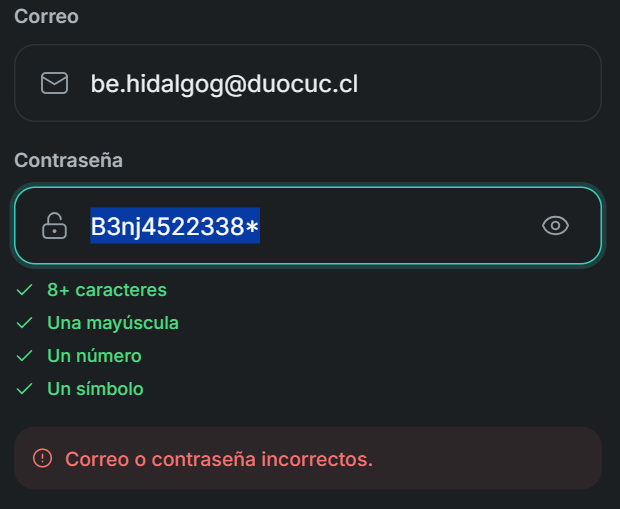

**Nota / incidencia:** N/A

---

### ACC-03 - Bloqueo tras intentos fallidos

- **Rol:** Ambos
- **Prioridad:** Alta

**Precondición:** Cuenta de prueba que se pueda bloquear.

**Pasos:**

1. Fallar la contraseña 5 veces seguidas.
2. Intentar con la contraseña correcta.

**Resultado esperado:** Tras el quinto fallo aparece el aviso de demasiados intentos. Durante el bloqueo, ni la contraseña correcta entra; tras unos minutos sí.

**Estado:**

- [x] Pasa
- [ ] Falla
- [ ] Bloqueado

| Campo                         | Completar               |
| ----------------------------- | ----------------------- |
| Probó                         | Benjamín Hidalgo        |
| Fecha                         | 06-11-26                |
| Hora                          | 22:34                   |
| Dispositivo                   | PC                      |
| Sistema operativo / navegador | Windows - Google Chrome |
| Versión / build               |                         |

**Resultado obtenido:** Muestra en pantalla "Demasiados intentos fallidos. espera unos minutos e intenta denuevo"

**Evidencia:**
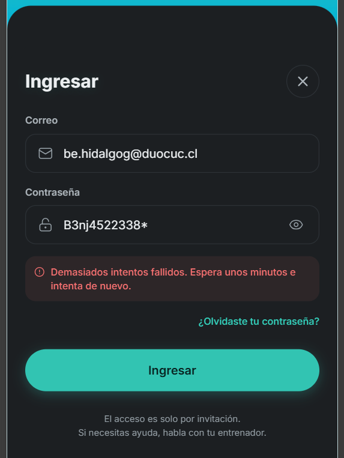

**Nota / incidencia:**

<!-- Agregar observaciones, motivo del bloqueo o enlace al error reportado. -->

---

### ACC-04 - Recuperar contraseña en tres pasos

- **Rol:** Ambos
- **Prioridad:** Alta

**Precondición:** Acceso al correo de la cuenta de prueba.

**Pasos:**

1. Tocar «¿Olvidaste tu contraseña?» e ingresar el correo.
2. Ingresar el código de 6 dígitos que llega por correo.
3. Definir una contraseña nueva que cumpla las 4 reglas.
4. Iniciar sesión con la nueva.

**Resultado esperado:** Llega el correo con el código, el código se acepta una vez, la contraseña nueva funciona y la anterior ya no.

**Estado:**

- [ ] Pasa
- [x] Falla
- [ ] Bloqueado

| Campo                         | Completar               |
| ----------------------------- | ----------------------- |
| Probó                         | Benjamín Hidalgo        |
| Fecha                         | 06-11-26                |
| Hora                          | 22:34                   |
| Dispositivo                   | PC                      |
| Sistema operativo / navegador | Windows - Google Chrome |
| Versión / build               |                         |

**Resultado obtenido:** Envia un correo exitosamente a mi bandeja de entrada con un enlace que debería llevarme donde cambiar la contraseña. Sin embargo este link no lleva a ningún lado. 

**Evidencia:**
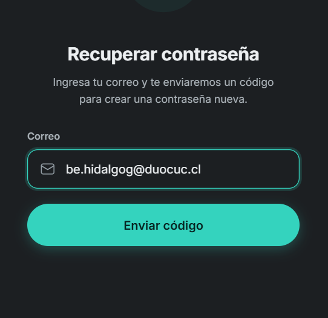

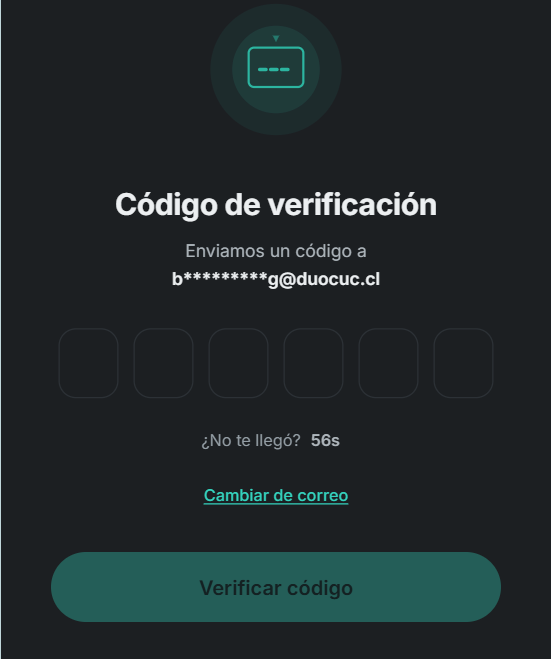

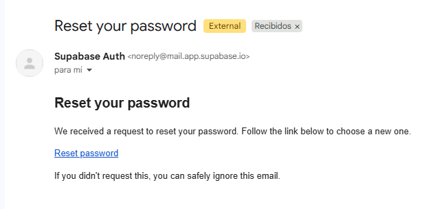

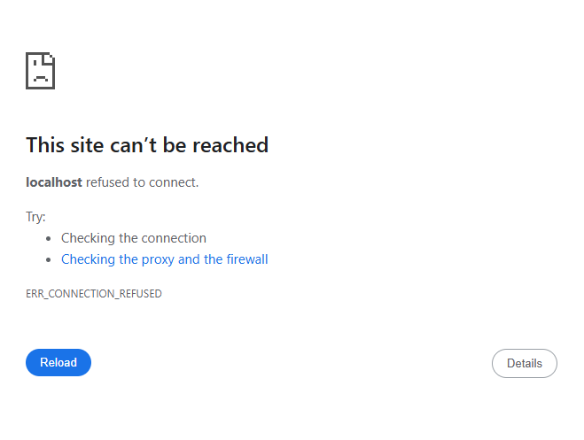
**Nota / incidencia:**

<!-- Agregar observaciones, motivo del bloqueo o enlace al error reportado. -->

---

### ACC-05 - Reglas de contraseña nueva

- **Rol:** Ambos
- **Prioridad:** Media

**Precondición:** Paso de nueva contraseña (recuperación o invitación).

**Pasos:**

1. Probar «abc», «abcdefgh», «Abcdefgh» y «Abcdefg1!».

**Resultado esperado:** Las tres primeras muestran qué regla falta (8+ caracteres, mayúscula, número, símbolo). La última se acepta.

**Estado:**

- [ ] Pasa
- [ ] Falla
- [x] Bloqueado

| Campo                         | Completar               |
| ----------------------------- | ----------------------- |
| Probó                         | Benjamín Hidalgo        |
| Fecha                         | 06-11-26                |
| Hora                          | 22:34                   |
| Dispositivo                   | PC                      |
| Sistema operativo / navegador | Windows - Google Chrome |
| Versión / build               |                         |

**Resultado obtenido:**

<!-- Describir lo que ocurrió al ejecutar el caso. -->

**Evidencia:**

<!-- Agregar enlaces o rutas de capturas, videos o logs. -->

**Nota / incidencia:** No se puede probar aún por que la prueba de ACC-04 falló.

---

### ACC-06 - Sesión única por cuenta

- **Rol:** Ambos
- **Prioridad:** Alta

**Precondición:** Dos dispositivos con la app.

**Pasos:**

1. Iniciar sesión en el dispositivo A.
2. Iniciar sesión con la misma cuenta en el dispositivo B.
3. Volver a A y tocar cualquier sección.

**Resultado esperado:** A muestra el modal «Sesión cerrada» con «Entendido» y vuelve al inicio de sesión. B sigue funcionando.

**Estado:**

- [ ] Pasa
- [ ] Falla
- [ ] Bloqueado

| Campo | Completar |
| --- | --- |
| Probó | |
| Fecha | |
| Hora | |
| Dispositivo | |
| Sistema operativo / navegador | |
| Versión / build | |

**Resultado obtenido:** Se inició sesión desde el navegador y luego desde dispositivo móvil por safari. La cuenta se cerró correctamente en el primer dispositivo.

**Evidencia:**
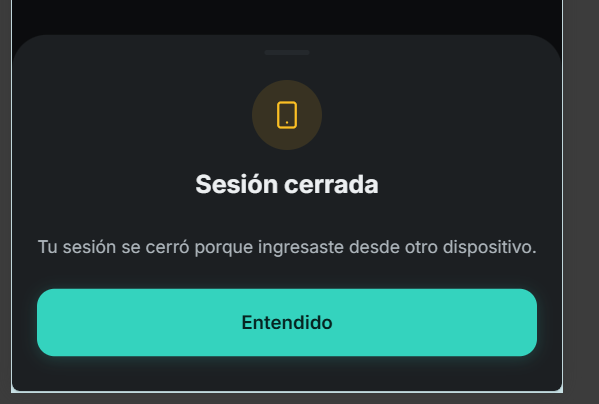
**Nota / incidencia:** N/A

---

### ACC-07 - Cerrar sesión

- **Rol:** Ambos
- **Prioridad:** Media

**Precondición:** Sesión iniciada.

**Pasos:**

1. Ir a Perfil → Cerrar sesión.
2. Usar el botón atrás del sistema.

**Resultado esperado:** Vuelve al inicio de sesión y atrás no muestra datos de la cuenta.

**Estado:**

- [x] Pasa
- [ ] Falla
- [ ] Bloqueado

| Campo                         | Completar               |
| ----------------------------- | ----------------------- |
| Probó                         | Benjamín Hidalgo        |
| Fecha                         | 07-11-26                |
| Hora                          | 12:14                   |
| Dispositivo                   | PC                      |
| Sistema operativo / navegador | Windows - Google Chrome |
| Versión / build               |                         |

**Resultado obtenido:** Se logra cerrar sesión y al retroceder solo muestra la página de login.

**Evidencia:**
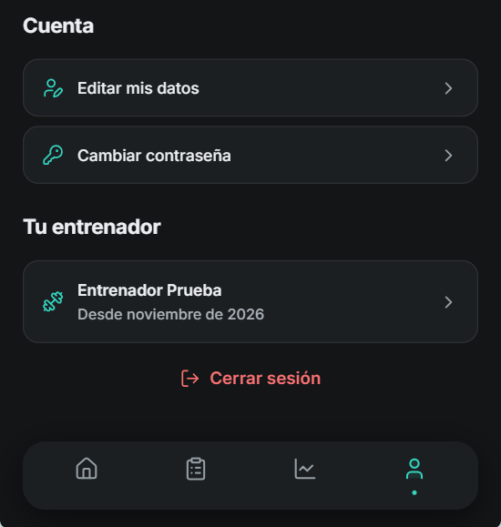

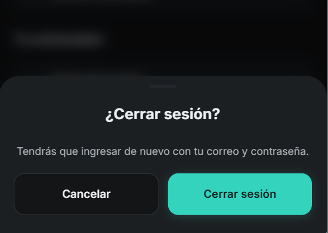

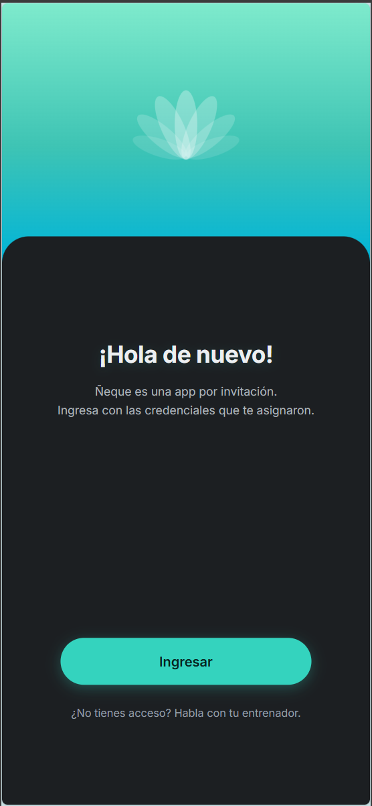

**Nota / incidencia:** N/A

---

### ACC-08 - Acceso web solo desde móvil

- **Rol:** Sistema
- **Prioridad:** Media

**Precondición:** NEQUE_WEB_ACCESS = mobile en Vercel.

**Pasos:**

1. Abrir el dominio en Chrome de escritorio.
2. Abrir el dominio en Safari del iPhone.

**Resultado esperado:** En escritorio aparece «Ñeque está disponible solo en la app». En el móvil se puede usar la app completa.

**Estado:**

- [x] Pasa
- [ ] Falla
- [ ] Bloqueado

| Campo                         | Completar               |
| ----------------------------- | ----------------------- |
| Probó                         | Benjamín Hidalgo        |
| Fecha                         | 07-11-26                |
| Hora                          | 12:14                   |
| Dispositivo                   | PC                      |
| Sistema operativo / navegador | Windows - Google Chrome |
| Versión / build               |                         |

**Resultado obtenido:** Solo funciona desde el navegador si emulo un dispositivo movil. Si entro con versión de escritorio no funciona la app.

**Evidencia:**
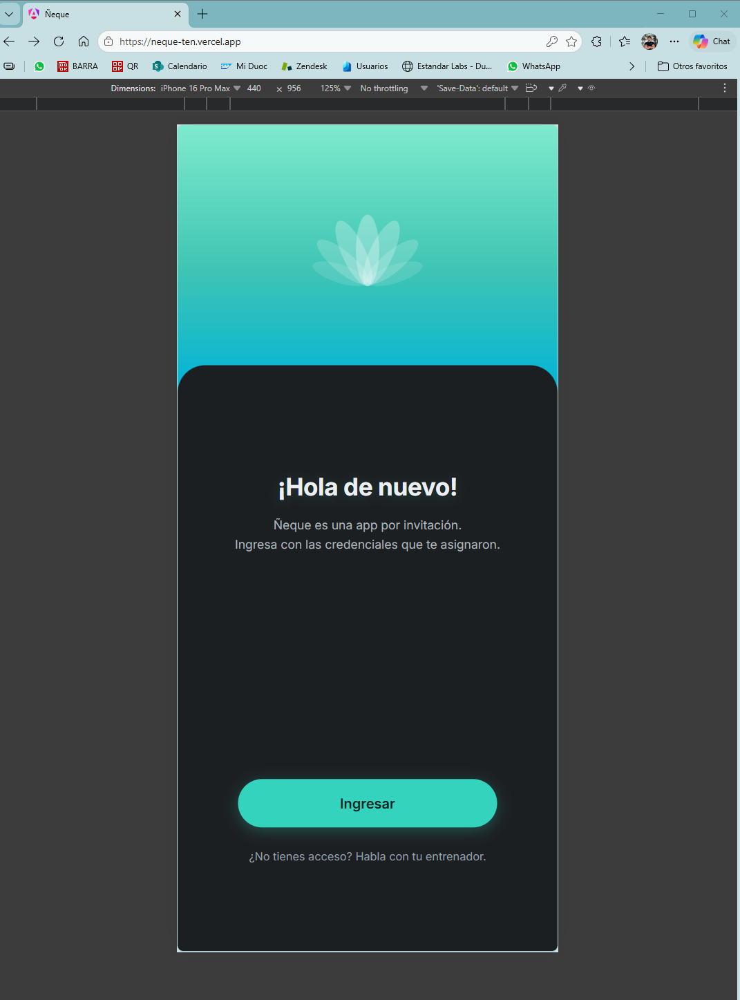

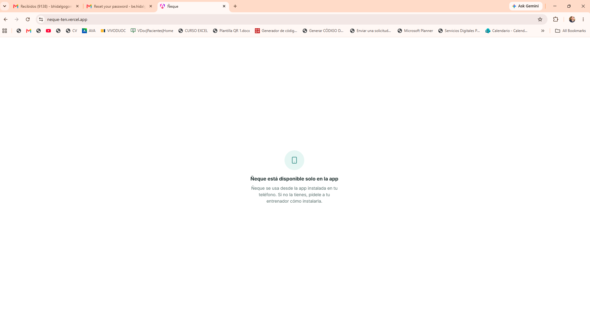

**Nota / incidencia:** Cabe destacar que no pude hacer la prueba para solo app movil puesto a que no tengo ni la IPA instalada ni acceso a la flag.

---

## INV - Invitaciones

### INV-01 - Registrar alumno emite su invitación

- **Rol:** Entrenador
- **Prioridad:** Alta

**Precondición:** Entrenador con sesión.

**Pasos:**

1. Alumnos → +.
2. Completar nombre, apellido, correo y teléfono válidos y guardar.

**Resultado esperado:** El alumno aparece en Activos y su ficha muestra el panel de acceso con la invitación vigente por 48 h.

**Estado:**

- [x] Pasa
- [ ] Falla
- [ ] Bloqueado

| Campo                         | Completar                |
| ----------------------------- | ------------------------ |
| Probó                         | Benjamín Hidalgo         |
| Fecha                         | 08-11-26                 |
| Hora                          | 20:50                    |
| Dispositivo                   | PC                       |
| Sistema operativo / navegador | Windows - Microsoft Edge |
| Versión / build               |                          |

**Resultado obtenido:** El alumno aparece en el apartado de Activos.

**Evidencia:**
Se creó el alumno con el nombre *Alumno Prueba 3*
Se puede ver correctamente en el panel de alumnos activos:
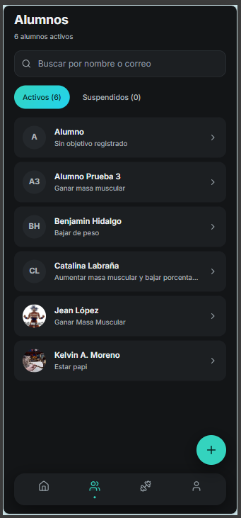

**Nota / incidencia:** N/A

---

### INV-02 - Validaciones del alta de alumno

- **Rol:** Entrenador
- **Prioridad:** Media

**Precondición:** Formulario de alta abierto.

**Pasos:**

1. Guardar vacío.
2. Ingresar teléfono «12ab».
3. Ingresar un correo ya usado.

**Resultado esperado:** Cada error aparece junto a su campo al intentar guardar. El correo duplicado avisa sin crear un alumno repetido.

**Estado:**

- [x] Pasa
- [ ] Falla
- [ ] Bloqueado

| Campo                         | Completar                |
| ----------------------------- | ------------------------ |
| Probó                         | Benjamín Hidalgo         |
| Fecha                         | 08-11-26                 |
| Hora                          | 21:04                    |
| Dispositivo                   | PC                       |
| Sistema operativo / navegador | Windows - Microsoft Edge |
| Versión / build               |                          |

**Resultado obtenido:**
1. Cuando se guarda vació no permite continuar mostrando en rojo los campos de nombre, apellido y correo.
2. Al ingresar el teléfono 12ab automáticamente la casilla se pone en rojo mostrando "Solo números y espacios, entre 8 y 16."
3. Al ingresar un correo ya usado aparece en pantalla que ya se ha creado una cuenta con ese correo electrónico.
**Evidencia:**
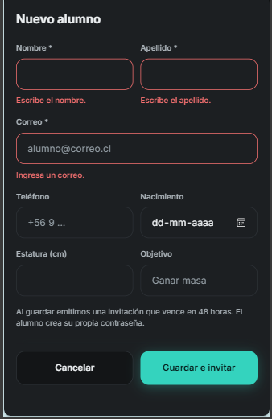

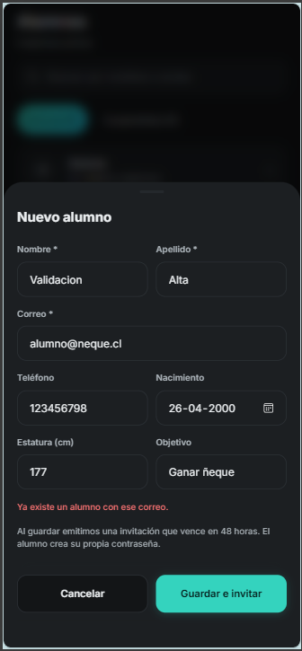

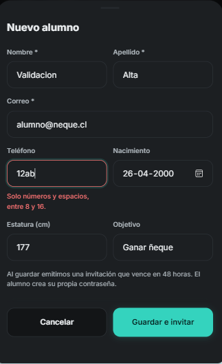

**Nota / incidencia:** 

---

### INV-03 - Compartir invitación, QR y reemitir

- **Rol:** Entrenador
- **Prioridad:** Media

**Precondición:** Alumno con invitación vigente.

**Pasos:**

1. Tocar Compartir y elegir una app.
2. Tocar Ver QR.
3. Tocar Reemitir.

**Resultado esperado:** Se abre la hoja nativa con el enlace. El QR se ve completo. Al reemitir, el enlace anterior deja de funcionar.

**Estado:**

- [ ] Pasa
- [ ] Falla
- [ ] Bloqueado

| Campo                         | Completar                |
| ----------------------------- | ------------------------ |
| Probó                         | Benjamín Hidalgo         |
| Fecha                         | 08-11-26                 |
| Hora                          | 21:04                    |
| Dispositivo                   | PC                       |
| Sistema operativo / navegador | Windows - Microsoft Edge |
| Versión / build               |                          |

**Resultado obtenido:**

<!-- Describir lo que ocurrió al ejecutar el caso. -->

**Evidencia:**

<!-- Agregar enlaces o rutas de capturas, videos o logs. -->

**Nota / incidencia:**

<!-- Agregar observaciones, motivo del bloqueo o enlace al error reportado. -->

---

### INV-04 - Aceptar invitación en otro dispositivo

- **Rol:** Alumno
- **Prioridad:** Alta

**Precondición:** Enlace de invitación vigente.

**Pasos:**

1. Abrir el enlace en otro teléfono.
2. Crear la contraseña.
3. Iniciar sesión.

**Resultado esperado:** El alumno define su contraseña, entra a su Inicio y ve su rutina si tiene una asignada.

**Estado:**

- [x] Pasa
- [ ] Falla
- [ ] Bloqueado

| Campo                         | Completar                |
| ----------------------------- | ------------------------ |
| Probó                         | Benjamín Hidalgo         |
| Fecha                         | 08-11-26                 |
| Hora                          | 21:04                    |
| Dispositivo                   | PC                       |
| Sistema operativo / navegador | Windows - Microsoft Edge |
| Versión / build               |                          |

**Resultado obtenido:**
El Alumno puede ingresar y ver su rutina asignada.

**Evidencia:**
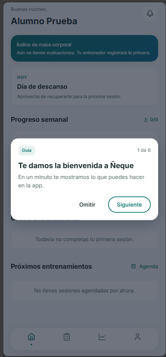

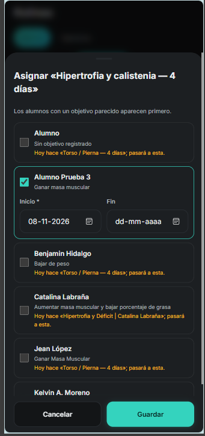

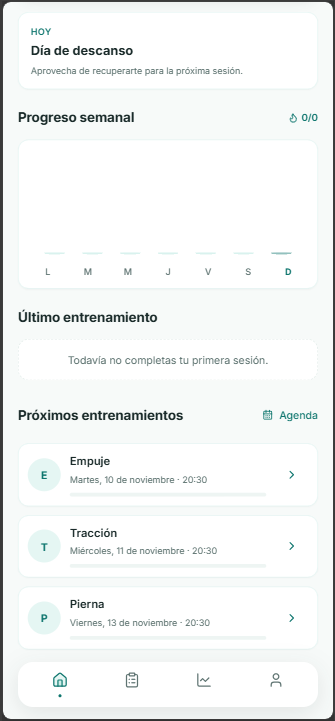

**Nota / incidencia:** 

---

### INV-05 - Invitación vencida o usada

- **Rol:** Alumno
- **Prioridad:** Media

**Precondición:** Enlace ya usado o reemitido.

**Pasos:**

1. Abrir el enlace viejo.

**Resultado esperado:** Aparece «Esta invitación no es válida o ya fue utilizada.» y no deja crear contraseña.

**Estado:**

- [ ] Pasa
- [ ] Falla
- [ ] Bloqueado

| Campo                         | Completar                |
| ----------------------------- | ------------------------ |
| Probó                         | Benjamín Hidalgo         |
| Fecha                         | 08-11-26                 |
| Hora                          | 21:27                    |
| Dispositivo                   | PC                       |
| Sistema operativo / navegador | Windows - Microsoft Edge |
| Versión / build               |                          |

**Resultado obtenido:**

<!-- Describir lo que ocurrió al ejecutar el caso. -->

**Evidencia:**

<!-- Agregar enlaces o rutas de capturas, videos o logs. -->

**Nota / incidencia:**

<!-- Agregar observaciones, motivo del bloqueo o enlace al error reportado. -->

---

## ALU - Alumnos y ficha

### ALU-01 - Buscar alumno sin importar tildes

- **Rol:** Entrenador
- **Prioridad:** Media

**Precondición:** Al menos un alumno con tilde en el nombre.

**Pasos:**

1. Buscar «lopez» y luego «López».
2. Buscar por parte del correo.

**Resultado esperado:** Ambas búsquedas encuentran al alumno; el botón X limpia la búsqueda.

**Estado:**

- [x] Pasa
- [ ] Falla
- [ ] Bloqueado

| Campo                         | Completar                |
| ----------------------------- | ------------------------ |
| Probó                         | Benjamín Hidalgo         |
| Fecha                         | 08-11-26                 |
| Hora                          | 21:04                    |
| Dispositivo                   | PC                       |
| Sistema operativo / navegador | Windows - Microsoft Edge |
| Versión / build               |                          |

**Resultado obtenido:** Encuentra con todos los parámetros ingresados.

**Evidencia:**
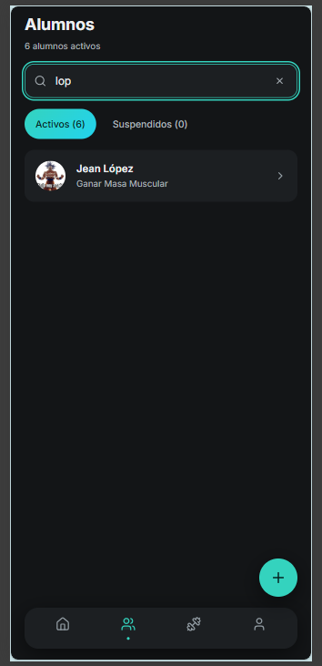

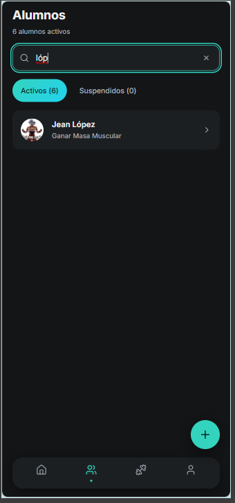

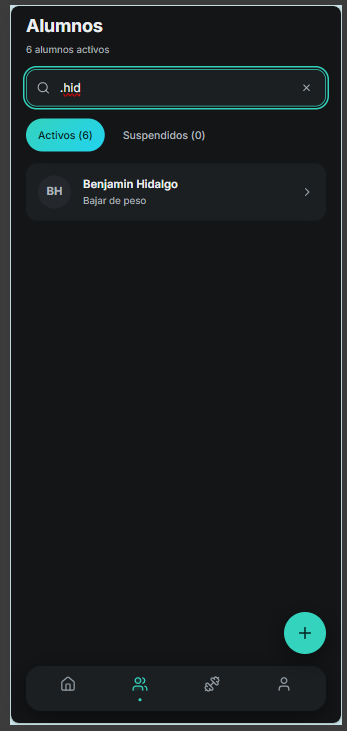

**Nota / incidencia:**

---

### ALU-02 - Editar datos de la ficha

- **Rol:** Entrenador
- **Prioridad:** Media

**Precondición:** Ficha de un alumno.

**Pasos:**

1. Datos → Editar.
2. Cambiar teléfono y objetivo y guardar.

**Resultado esperado:** La ficha muestra los datos nuevos sin recargar. Un teléfono inválido se rechaza junto al campo.

**Estado:**

- [x] Pasa
- [ ] Falla
- [ ] Bloqueado

| Campo                         | Completar                |
| ----------------------------- | ------------------------ |
| Probó                         | Benjamín Hidalgo         |
| Fecha                         | 08-11-26                 |
| Hora                          | 21:34                    |
| Dispositivo                   | PC                       |
| Sistema operativo / navegador | Windows - Microsoft Edge |
| Versión / build               |                          |

**Resultado obtenido:**
La ficha se actualiza correctamente y se aplican las validaciones correspondientes.

**Evidencia:**
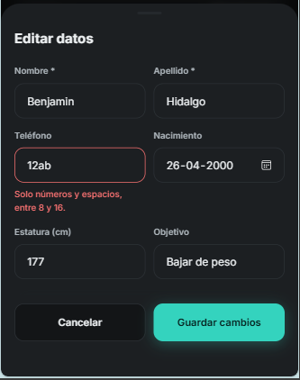

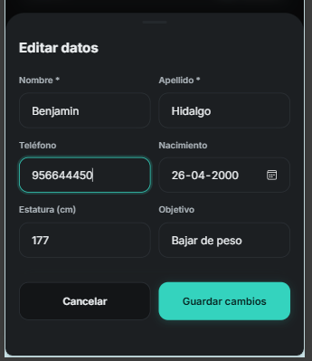

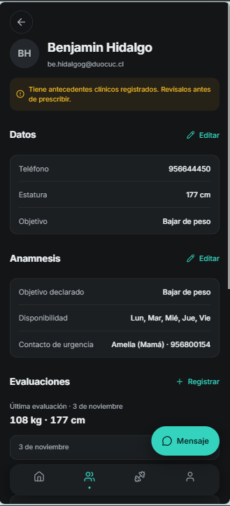

**Nota / incidencia:**

---

### ALU-03 - Registrar anamnesis

- **Rol:** Entrenador
- **Prioridad:** Alta

**Precondición:** Alumno sin anamnesis.

**Pasos:**

1. Anamnesis → Registrar.
2. Guardar sin objetivo ni días.
3. Completar objetivo, marcar días y un antecedente médico; guardar.

**Resultado esperado:** Sin objetivo o sin días no guarda y lo explica. Con antecedentes, la ficha muestra el aviso «Tiene antecedentes clínicos registrados».

**Estado:**

- [x] Pasa
- [ ] Falla
- [ ] Bloqueado

| Campo                         | Completar                |
| ----------------------------- | ------------------------ |
| Probó                         | Benjamín Hidalgo         |
| Fecha                         | 08-11-26                 |
| Hora                          | 21:34                    |
| Dispositivo                   | PC                       |
| Sistema operativo / navegador | Windows - Microsoft Edge |
| Versión / build               |                          |

**Resultado obtenido:** Todos los parámetros y validaciones se cumplen con éxito.

**Evidencia:**
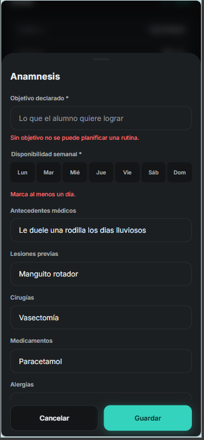

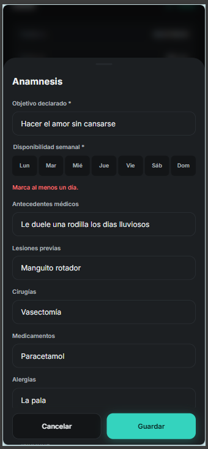

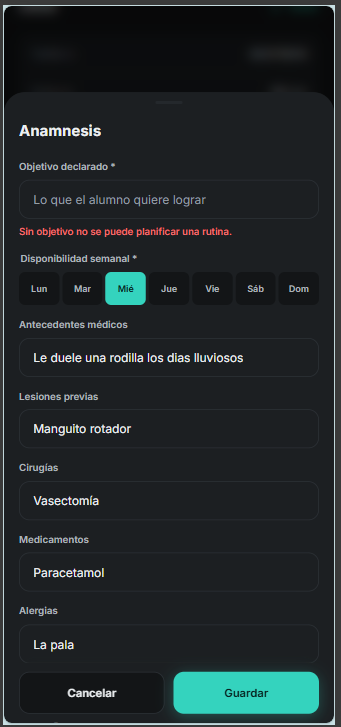

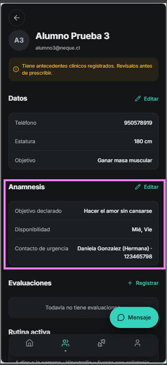

**Nota / incidencia:**

---

### ALU-04 - Textos largos en la anamnesis

- **Rol:** Entrenador
- **Prioridad:** Media

**Precondición:** Formulario de anamnesis.

**Pasos:**

1. Escribir un antecedente más largo que el campo.
2. Deslizar el dedo horizontalmente sobre el campo.

**Resultado esperado:** El texto se puede recorrer deslizando y se guarda completo.

**Estado:**

- [ ] Pasa
- [x] Falla
- [ ] Bloqueado

| Campo                         | Completar        |
| ----------------------------- | ---------------- |
| Probó                         | Benjamín Hidalgo |
| Fecha                         | 08-11-26         |
| Hora                          | 21:44            |
| Dispositivo                   | iPhone 14        |
| Sistema operativo / navegador | IOS - Safari     |
| Versión / build               |                  |

**Resultado obtenido:** No funciona se desplaza el texto al deslizar con el dedo.

**Evidencia:**

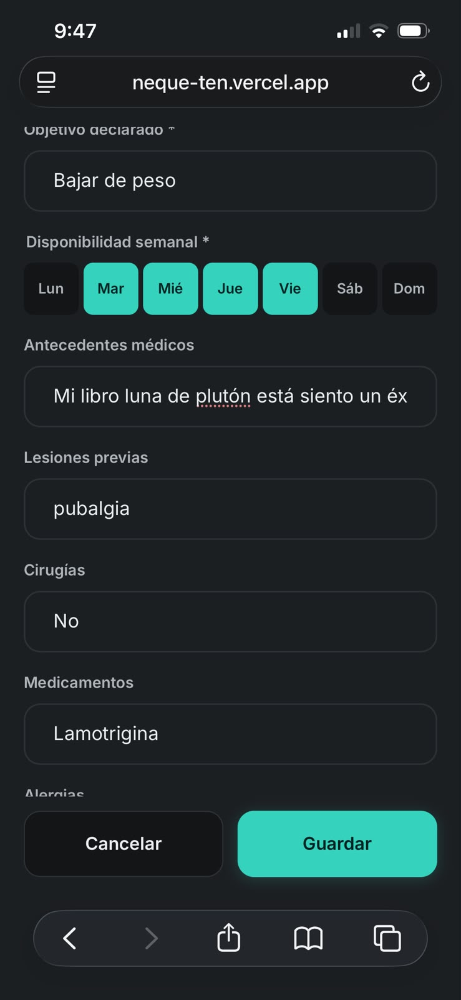

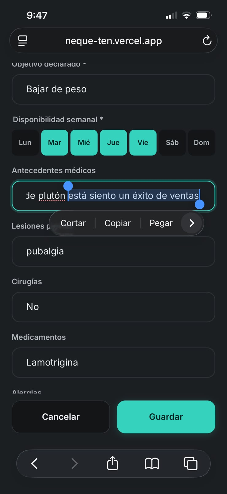
**Nota / incidencia:** Si selecciono el texto se mueve pero no es la idea.

---

### ALU-05 - Registrar evaluación física

- **Rol:** Entrenador
- **Prioridad:** Alta

**Precondición:** Ficha de un alumno.

**Pasos:**

1. Evaluaciones → Registrar.
2. Ingresar peso 72,5 y estatura 175; guardar.

**Resultado esperado:** Aparece «Última evaluación · fecha» con «72.5 kg · 175 cm». El alumno ve su IMC en su Inicio.

**Estado:**

- [x] Pasa
- [ ] Falla
- [ ] Bloqueado

| Campo                         | Completar                |
| ----------------------------- | ------------------------ |
| Probó                         | Benjamín Hidalgo         |
| Fecha                         | 08-11-26                 |
| Hora                          | 21:34                    |
| Dispositivo                   | PC                       |
| Sistema operativo / navegador | Windows - Microsoft Edge |
| Versión / build               |                          |

**Resultado obtenido:** Se guarda correctamente

**Evidencia:**

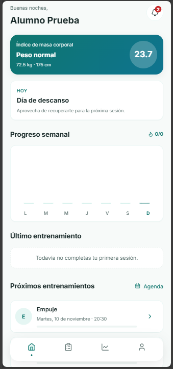

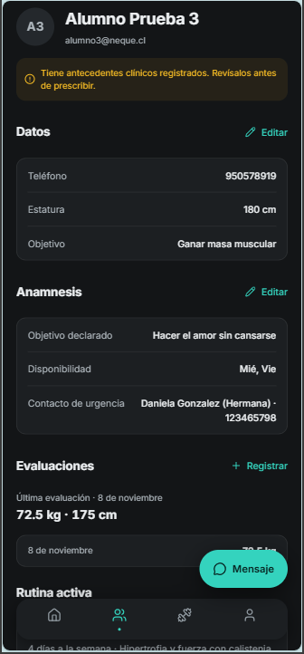

**Nota / incidencia:**

---

### ALU-06 - Suspender y reactivar

- **Rol:** Entrenador
- **Prioridad:** Alta

**Precondición:** Alumno activo con sesión abierta en otro teléfono.

**Pasos:**

1. Ficha → Suspender cuenta → confirmar.
2. En el teléfono del alumno, tocar algo.
3. Reactivar.

**Resultado esperado:** El alumno pasa a Suspendidos y queda fuera de la app. Al reactivar puede volver a entrar con su contraseña y su historial sigue ahí.

**Estado:**

- [ ] Pasa
- [ ] Falla
- [ ] Bloqueado

| Campo | Completar |
| --- | --- |
| Probó | |
| Fecha | |
| Hora | |
| Dispositivo | |
| Sistema operativo / navegador | |
| Versión / build | |

**Resultado obtenido:**

<!-- Describir lo que ocurrió al ejecutar el caso. -->

**Evidencia:**

<!-- Agregar enlaces o rutas de capturas, videos o logs. -->

**Nota / incidencia:**

<!-- Agregar observaciones, motivo del bloqueo o enlace al error reportado. -->

---

### ALU-07 - Foto de perfil en la ficha

- **Rol:** Entrenador
- **Prioridad:** Baja

**Precondición:** Alumno que subió foto de perfil.

**Pasos:**

1. Abrir su ficha.

**Resultado esperado:** La cabecera muestra la foto; sin foto, las iniciales.

**Estado:**

- [ ] Pasa
- [ ] Falla
- [ ] Bloqueado

| Campo | Completar |
| --- | --- |
| Probó | |
| Fecha | |
| Hora | |
| Dispositivo | |
| Sistema operativo / navegador | |
| Versión / build | |

**Resultado obtenido:**

<!-- Describir lo que ocurrió al ejecutar el caso. -->

**Evidencia:**

<!-- Agregar enlaces o rutas de capturas, videos o logs. -->

**Nota / incidencia:**

<!-- Agregar observaciones, motivo del bloqueo o enlace al error reportado. -->

---

## RUT - Rutinas y ejercicios

### RUT-01 - Crear rutina de 5 ejercicios en menos de 3 minutos

- **Rol:** Entrenador
- **Prioridad:** Alta

**Precondición:** Entrenador con sesión.

**Pasos:**

1. Rutinas → +.
2. Nombre, objetivo, un día con 5 ejercicios; guardar.

**Resultado esperado:** La rutina se crea sin errores, aparece en «Sin asignar» y se abre el paso de asignar alumnos.

**Estado:**

- [ ] Pasa
- [ ] Falla
- [ ] Bloqueado

| Campo | Completar |
| --- | --- |
| Probó | |
| Fecha | |
| Hora | |
| Dispositivo | |
| Sistema operativo / navegador | |
| Versión / build | |

**Resultado obtenido:**

<!-- Describir lo que ocurrió al ejecutar el caso. -->

**Evidencia:**

<!-- Agregar enlaces o rutas de capturas, videos o logs. -->

**Nota / incidencia:**

<!-- Agregar observaciones, motivo del bloqueo o enlace al error reportado. -->

---

### RUT-02 - Validaciones del constructor

- **Rol:** Entrenador
- **Prioridad:** Media

**Precondición:** Constructor abierto.

**Pasos:**

1. Guardar sin nombre.
2. Agregar dos días con el mismo día de la semana.
3. Dejar un día sin título.

**Resultado esperado:** Cada caso muestra su error y no guarda.

**Estado:**

- [ ] Pasa
- [ ] Falla
- [ ] Bloqueado

| Campo | Completar |
| --- | --- |
| Probó | |
| Fecha | |
| Hora | |
| Dispositivo | |
| Sistema operativo / navegador | |
| Versión / build | |

**Resultado obtenido:**

<!-- Describir lo que ocurrió al ejecutar el caso. -->

**Evidencia:**

<!-- Agregar enlaces o rutas de capturas, videos o logs. -->

**Nota / incidencia:**

<!-- Agregar observaciones, motivo del bloqueo o enlace al error reportado. -->

---

### RUT-03 - Editar tocando la tarjeta

- **Rol:** Entrenador
- **Prioridad:** Alta

**Precondición:** Rutina existente.

**Pasos:**

1. En Rutinas, tocar la tarjeta (no los botones).
2. Tocar «Asignar alumnos» en otra tarjeta.

**Resultado esperado:** Tocar la tarjeta abre el formulario con la rutina cargada; los botones de la tarjeta hacen su acción sin abrir el formulario. No existe botón Editar.

**Estado:**

- [ ] Pasa
- [ ] Falla
- [ ] Bloqueado

| Campo | Completar |
| --- | --- |
| Probó | |
| Fecha | |
| Hora | |
| Dispositivo | |
| Sistema operativo / navegador | |
| Versión / build | |

**Resultado obtenido:**

<!-- Describir lo que ocurrió al ejecutar el caso. -->

**Evidencia:**

<!-- Agregar enlaces o rutas de capturas, videos o logs. -->

**Nota / incidencia:**

<!-- Agregar observaciones, motivo del bloqueo o enlace al error reportado. -->

---

### RUT-04 - Hora de inicio por día

- **Rol:** Entrenador
- **Prioridad:** Alta

**Precondición:** Rutina asignada.

**Pasos:**

1. Editar la rutina y poner 18:30 a un día.
2. Guardar.
3. Ver Inicio del entrenador y el Inicio del alumno ese día.

**Resultado esperado:** La cabecera del día muestra la hora. «Hoy» y «Hoy te toca» muestran 18:30. Un día sin hora muestra «Sin hora» (entrenador) o solo el día (alumno).

**Estado:**

- [ ] Pasa
- [ ] Falla
- [ ] Bloqueado

| Campo | Completar |
| --- | --- |
| Probó | |
| Fecha | |
| Hora | |
| Dispositivo | |
| Sistema operativo / navegador | |
| Versión / build | |

**Resultado obtenido:**

<!-- Describir lo que ocurrió al ejecutar el caso. -->

**Evidencia:**

<!-- Agregar enlaces o rutas de capturas, videos o logs. -->

**Nota / incidencia:**

<!-- Agregar observaciones, motivo del bloqueo o enlace al error reportado. -->

---

### RUT-05 - Asignar mueve al alumno desde su rutina anterior

- **Rol:** Entrenador
- **Prioridad:** Alta

**Precondición:** Alumno con rutina A; rutina B sin él.

**Pasos:**

1. Asignar el alumno a B desde hoy.

**Resultado esperado:** A deja de tenerlo, B lo muestra. El alumno ve solo las sesiones de B; lo entrenado con A queda guardado.

**Estado:**

- [ ] Pasa
- [ ] Falla
- [ ] Bloqueado

| Campo | Completar |
| --- | --- |
| Probó | |
| Fecha | |
| Hora | |
| Dispositivo | |
| Sistema operativo / navegador | |
| Versión / build | |

**Resultado obtenido:**

<!-- Describir lo que ocurrió al ejecutar el caso. -->

**Evidencia:**

<!-- Agregar enlaces o rutas de capturas, videos o logs. -->

**Nota / incidencia:**

<!-- Agregar observaciones, motivo del bloqueo o enlace al error reportado. -->

---

### RUT-06 - Guardar una rutina no duplica sesiones

- **Rol:** Entrenador
- **Prioridad:** Media

**Precondición:** Rutina asignada con sesiones esta semana.

**Pasos:**

1. Editar y guardar sin cambios.
2. Ver el progreso semanal del alumno.

**Resultado esperado:** El total semanal coincide con los días de la rutina; no aparecen sesiones repetidas el mismo día.

**Estado:**

- [ ] Pasa
- [ ] Falla
- [ ] Bloqueado

| Campo | Completar |
| --- | --- |
| Probó | |
| Fecha | |
| Hora | |
| Dispositivo | |
| Sistema operativo / navegador | |
| Versión / build | |

**Resultado obtenido:**

<!-- Describir lo que ocurrió al ejecutar el caso. -->

**Evidencia:**

<!-- Agregar enlaces o rutas de capturas, videos o logs. -->

**Nota / incidencia:**

<!-- Agregar observaciones, motivo del bloqueo o enlace al error reportado. -->

---

### RUT-07 - Duplicar rutina

- **Rol:** Entrenador
- **Prioridad:** Media

**Precondición:** Rutina con alumnos.

**Pasos:**

1. Tocar Duplicar.

**Resultado esperado:** Se crea «Nombre (copia)» sin alumnos, en «Sin asignar», y se abre para editar.

**Estado:**

- [ ] Pasa
- [ ] Falla
- [ ] Bloqueado

| Campo | Completar |
| --- | --- |
| Probó | |
| Fecha | |
| Hora | |
| Dispositivo | |
| Sistema operativo / navegador | |
| Versión / build | |

**Resultado obtenido:**

<!-- Describir lo que ocurrió al ejecutar el caso. -->

**Evidencia:**

<!-- Agregar enlaces o rutas de capturas, videos o logs. -->

**Nota / incidencia:**

<!-- Agregar observaciones, motivo del bloqueo o enlace al error reportado. -->

---

### RUT-08 - Eliminar rutina con alumnos

- **Rol:** Entrenador
- **Prioridad:** Media

**Precondición:** Rutina con un alumno.

**Pasos:**

1. Tocar Eliminar.

**Resultado esperado:** La confirmación nombra al alumno que queda sin rutina. Al confirmar, la rutina desaparece.

**Estado:**

- [ ] Pasa
- [ ] Falla
- [ ] Bloqueado

| Campo | Completar |
| --- | --- |
| Probó | |
| Fecha | |
| Hora | |
| Dispositivo | |
| Sistema operativo / navegador | |
| Versión / build | |

**Resultado obtenido:**

<!-- Describir lo que ocurrió al ejecutar el caso. -->

**Evidencia:**

<!-- Agregar enlaces o rutas de capturas, videos o logs. -->

**Nota / incidencia:**

<!-- Agregar observaciones, motivo del bloqueo o enlace al error reportado. -->

---

### RUT-09 - Modificar ejercicio propio

- **Rol:** Entrenador
- **Prioridad:** Media

**Precondición:** Ejercicio propio en Mis ejercicios.

**Pasos:**

1. Tocar el ejercicio → Modificar ejercicio.
2. Cambiar el nombre y guardar.

**Resultado esperado:** El nombre cambia en el catálogo y en las rutinas que lo usan.

**Estado:**

- [ ] Pasa
- [ ] Falla
- [ ] Bloqueado

| Campo | Completar |
| --- | --- |
| Probó | |
| Fecha | |
| Hora | |
| Dispositivo | |
| Sistema operativo / navegador | |
| Versión / build | |

**Resultado obtenido:**

<!-- Describir lo que ocurrió al ejecutar el caso. -->

**Evidencia:**

<!-- Agregar enlaces o rutas de capturas, videos o logs. -->

**Nota / incidencia:**

<!-- Agregar observaciones, motivo del bloqueo o enlace al error reportado. -->

---

### RUT-10 - No se elimina un ejercicio en uso

- **Rol:** Entrenador
- **Prioridad:** Media

**Precondición:** Ejercicio propio usado en una rutina vigente.

**Pasos:**

1. Tocarlo → Eliminar ejercicio → confirmar.

**Resultado esperado:** Aparece «Este ejercicio está en la rutina «…». Quítalo de ella antes de eliminarlo.» y no se borra.

**Estado:**

- [ ] Pasa
- [ ] Falla
- [ ] Bloqueado

| Campo | Completar |
| --- | --- |
| Probó | |
| Fecha | |
| Hora | |
| Dispositivo | |
| Sistema operativo / navegador | |
| Versión / build | |

**Resultado obtenido:**

<!-- Describir lo que ocurrió al ejecutar el caso. -->

**Evidencia:**

<!-- Agregar enlaces o rutas de capturas, videos o logs. -->

**Nota / incidencia:**

<!-- Agregar observaciones, motivo del bloqueo o enlace al error reportado. -->

---

### RUT-11 - Catálogo público no editable

- **Rol:** Entrenador
- **Prioridad:** Baja

**Precondición:** Pestaña Ejercicios.

**Pasos:**

1. Tocar un ejercicio del Catálogo.

**Resultado esperado:** No ofrece modificar ni eliminar: solo los propios tienen opciones.

**Estado:**

- [ ] Pasa
- [ ] Falla
- [ ] Bloqueado

| Campo | Completar |
| --- | --- |
| Probó | |
| Fecha | |
| Hora | |
| Dispositivo | |
| Sistema operativo / navegador | |
| Versión / build | |

**Resultado obtenido:**

<!-- Describir lo que ocurrió al ejecutar el caso. -->

**Evidencia:**

<!-- Agregar enlaces o rutas de capturas, videos o logs. -->

**Nota / incidencia:**

<!-- Agregar observaciones, motivo del bloqueo o enlace al error reportado. -->

---

## ENT - Entrenamiento del alumno

### ENT-01 - Mi rutina muestra los días de la semana

- **Rol:** Alumno
- **Prioridad:** Alta

**Precondición:** Alumno con rutina asignada.

**Pasos:**

1. Abrir Mi rutina y recorrer los días.

**Resultado esperado:** Los días con entrenamiento tienen punto; cada uno muestra sus ejercicios con series × reps, carga y descanso.

**Estado:**

- [ ] Pasa
- [ ] Falla
- [ ] Bloqueado

| Campo | Completar |
| --- | --- |
| Probó | |
| Fecha | |
| Hora | |
| Dispositivo | |
| Sistema operativo / navegador | |
| Versión / build | |

**Resultado obtenido:**

<!-- Describir lo que ocurrió al ejecutar el caso. -->

**Evidencia:**

<!-- Agregar enlaces o rutas de capturas, videos o logs. -->

**Nota / incidencia:**

<!-- Agregar observaciones, motivo del bloqueo o enlace al error reportado. -->

---

### ENT-02 - Ejecutar sesión registrando carga real

- **Rol:** Alumno
- **Prioridad:** Alta

**Precondición:** Sesión de hoy pendiente.

**Pasos:**

1. Comenzar entrenamiento.
2. En una serie, cambiar el peso prescrito y confirmar.
3. Completar el resto.

**Resultado esperado:** Cada serie se guarda con el peso real; al terminar aparece la celebración y el día queda 100 %.

**Estado:**

- [ ] Pasa
- [ ] Falla
- [ ] Bloqueado

| Campo | Completar |
| --- | --- |
| Probó | |
| Fecha | |
| Hora | |
| Dispositivo | |
| Sistema operativo / navegador | |
| Versión / build | |

**Resultado obtenido:**

<!-- Describir lo que ocurrió al ejecutar el caso. -->

**Evidencia:**

<!-- Agregar enlaces o rutas de capturas, videos o logs. -->

**Nota / incidencia:**

<!-- Agregar observaciones, motivo del bloqueo o enlace al error reportado. -->

---

### ENT-03 - Saltar serie o ejercicio con motivo

- **Rol:** Alumno
- **Prioridad:** Media

**Precondición:** Sesión en curso.

**Pasos:**

1. Saltar una serie eligiendo «Molestia o dolor».

**Resultado esperado:** La serie queda saltada con su motivo y el entrenador lo ve en el detalle del entrenamiento.

**Estado:**

- [ ] Pasa
- [ ] Falla
- [ ] Bloqueado

| Campo | Completar |
| --- | --- |
| Probó | |
| Fecha | |
| Hora | |
| Dispositivo | |
| Sistema operativo / navegador | |
| Versión / build | |

**Resultado obtenido:**

<!-- Describir lo que ocurrió al ejecutar el caso. -->

**Evidencia:**

<!-- Agregar enlaces o rutas de capturas, videos o logs. -->

**Nota / incidencia:**

<!-- Agregar observaciones, motivo del bloqueo o enlace al error reportado. -->

---

### ENT-04 - Progreso semanal por porcentaje

- **Rol:** Alumno
- **Prioridad:** Alta

**Precondición:** Semana con un día completo y otro a medias.

**Pasos:**

1. Ver Inicio → Progreso semanal.

**Resultado esperado:** El día completo llena su barra; el contador muestra completados / planificados de la rutina vigente.

**Estado:**

- [ ] Pasa
- [ ] Falla
- [ ] Bloqueado

| Campo | Completar |
| --- | --- |
| Probó | |
| Fecha | |
| Hora | |
| Dispositivo | |
| Sistema operativo / navegador | |
| Versión / build | |

**Resultado obtenido:**

<!-- Describir lo que ocurrió al ejecutar el caso. -->

**Evidencia:**

<!-- Agregar enlaces o rutas de capturas, videos o logs. -->

**Nota / incidencia:**

<!-- Agregar observaciones, motivo del bloqueo o enlace al error reportado. -->

---

### ENT-05 - Cambiar de día a un día libre

- **Rol:** Alumno
- **Prioridad:** Alta

**Precondición:** Entrenamiento de hoy sin empezar.

**Pasos:**

1. Mi rutina → Cambiar de día.
2. Revisar los días ofrecidos y elegir uno.

**Resultado esperado:** Solo aparecen días libres de esta semana desde hoy. El entrenamiento aparece en el día nuevo con «Lo moviste aquí desde…» y el original dice «Este día queda libre».

**Estado:**

- [ ] Pasa
- [ ] Falla
- [ ] Bloqueado

| Campo | Completar |
| --- | --- |
| Probó | |
| Fecha | |
| Hora | |
| Dispositivo | |
| Sistema operativo / navegador | |
| Versión / build | |

**Resultado obtenido:**

<!-- Describir lo que ocurrió al ejecutar el caso. -->

**Evidencia:**

<!-- Agregar enlaces o rutas de capturas, videos o logs. -->

**Nota / incidencia:**

<!-- Agregar observaciones, motivo del bloqueo o enlace al error reportado. -->

---

### ENT-06 - No se mueve un entrenamiento empezado

- **Rol:** Alumno
- **Prioridad:** Media

**Precondición:** Sesión en curso o completada.

**Pasos:**

1. Abrir Mi rutina ese día.

**Resultado esperado:** No aparece «Cambiar de día».

**Estado:**

- [ ] Pasa
- [ ] Falla
- [ ] Bloqueado

| Campo | Completar |
| --- | --- |
| Probó | |
| Fecha | |
| Hora | |
| Dispositivo | |
| Sistema operativo / navegador | |
| Versión / build | |

**Resultado obtenido:**

<!-- Describir lo que ocurrió al ejecutar el caso. -->

**Evidencia:**

<!-- Agregar enlaces o rutas de capturas, videos o logs. -->

**Nota / incidencia:**

<!-- Agregar observaciones, motivo del bloqueo o enlace al error reportado. -->

---

### ENT-07 - Rutina anterior no se muestra

- **Rol:** Alumno
- **Prioridad:** Media

**Precondición:** Alumno al que se le cambió la rutina.

**Pasos:**

1. Ver Inicio y Mi rutina.

**Resultado esperado:** Solo se ven sesiones de la rutina vigente; las de la anterior no aparecen.

**Estado:**

- [ ] Pasa
- [ ] Falla
- [ ] Bloqueado

| Campo | Completar |
| --- | --- |
| Probó | |
| Fecha | |
| Hora | |
| Dispositivo | |
| Sistema operativo / navegador | |
| Versión / build | |

**Resultado obtenido:**

<!-- Describir lo que ocurrió al ejecutar el caso. -->

**Evidencia:**

<!-- Agregar enlaces o rutas de capturas, videos o logs. -->

**Nota / incidencia:**

<!-- Agregar observaciones, motivo del bloqueo o enlace al error reportado. -->

---

## AGE - Agenda y citas

### AGE-01 - Agendar una cita

- **Rol:** Entrenador
- **Prioridad:** Alta

**Precondición:** Ficha de un alumno.

**Pasos:**

1. Próximas citas → Agendar.
2. Tipo Evaluación, mañana 10:00, 45 min; agendar.

**Resultado esperado:** La cita aparece «Por confirmar». El alumno recibe «Nueva cita agendada» y la ve en Mi agenda.

**Estado:**

- [ ] Pasa
- [ ] Falla
- [ ] Bloqueado

| Campo | Completar |
| --- | --- |
| Probó | |
| Fecha | |
| Hora | |
| Dispositivo | |
| Sistema operativo / navegador | |
| Versión / build | |

**Resultado obtenido:**

<!-- Describir lo que ocurrió al ejecutar el caso. -->

**Evidencia:**

<!-- Agregar enlaces o rutas de capturas, videos o logs. -->

**Nota / incidencia:**

<!-- Agregar observaciones, motivo del bloqueo o enlace al error reportado. -->

---

### AGE-02 - Validaciones de la cita

- **Rol:** Entrenador
- **Prioridad:** Media

**Precondición:** Formulario de cita.

**Pasos:**

1. Agendar sin fecha.
2. Agendar para una hora pasada.

**Resultado esperado:** Muestra «Elige la fecha y la hora de la cita.» y «Elige una fecha y hora futuras.»

**Estado:**

- [ ] Pasa
- [ ] Falla
- [ ] Bloqueado

| Campo | Completar |
| --- | --- |
| Probó | |
| Fecha | |
| Hora | |
| Dispositivo | |
| Sistema operativo / navegador | |
| Versión / build | |

**Resultado obtenido:**

<!-- Describir lo que ocurrió al ejecutar el caso. -->

**Evidencia:**

<!-- Agregar enlaces o rutas de capturas, videos o logs. -->

**Nota / incidencia:**

<!-- Agregar observaciones, motivo del bloqueo o enlace al error reportado. -->

---

### AGE-03 - Confirmar una cita

- **Rol:** Alumno
- **Prioridad:** Alta

**Precondición:** Cita por confirmar.

**Pasos:**

1. Mi agenda → el día de la cita → Confirmar.

**Resultado esperado:** Pasa a «Confirmada» y el entrenador la ve confirmada en la ficha.

**Estado:**

- [ ] Pasa
- [ ] Falla
- [ ] Bloqueado

| Campo | Completar |
| --- | --- |
| Probó | |
| Fecha | |
| Hora | |
| Dispositivo | |
| Sistema operativo / navegador | |
| Versión / build | |

**Resultado obtenido:**

<!-- Describir lo que ocurrió al ejecutar el caso. -->

**Evidencia:**

<!-- Agregar enlaces o rutas de capturas, videos o logs. -->

**Nota / incidencia:**

<!-- Agregar observaciones, motivo del bloqueo o enlace al error reportado. -->

---

### AGE-04 - Reagendar una cita

- **Rol:** Entrenador
- **Prioridad:** Alta

**Precondición:** Cita confirmada.

**Pasos:**

1. Tocar la cita → Reagendar.
2. Cambiar la hora y guardar.

**Resultado esperado:** La cita vuelve a «Por confirmar» con la hora nueva y el alumno recibe «Cita reagendada».

**Estado:**

- [ ] Pasa
- [ ] Falla
- [ ] Bloqueado

| Campo | Completar |
| --- | --- |
| Probó | |
| Fecha | |
| Hora | |
| Dispositivo | |
| Sistema operativo / navegador | |
| Versión / build | |

**Resultado obtenido:**

<!-- Describir lo que ocurrió al ejecutar el caso. -->

**Evidencia:**

<!-- Agregar enlaces o rutas de capturas, videos o logs. -->

**Nota / incidencia:**

<!-- Agregar observaciones, motivo del bloqueo o enlace al error reportado. -->

---

### AGE-05 - Cancelar con «Otro motivo»

- **Rol:** Entrenador
- **Prioridad:** Alta

**Precondición:** Cita vigente.

**Pasos:**

1. Tocar la cita → Cancelar cita.
2. Elegir «Otro motivo» sin nota y confirmar.
3. Escribir la nota y confirmar.

**Resultado esperado:** Sin nota no cancela y lo explica; con nota queda «Cancelada» y el alumno recibe el aviso.

**Estado:**

- [ ] Pasa
- [ ] Falla
- [ ] Bloqueado

| Campo | Completar |
| --- | --- |
| Probó | |
| Fecha | |
| Hora | |
| Dispositivo | |
| Sistema operativo / navegador | |
| Versión / build | |

**Resultado obtenido:**

<!-- Describir lo que ocurrió al ejecutar el caso. -->

**Evidencia:**

<!-- Agregar enlaces o rutas de capturas, videos o logs. -->

**Nota / incidencia:**

<!-- Agregar observaciones, motivo del bloqueo o enlace al error reportado. -->

---

### AGE-06 - Agenda global

- **Rol:** Entrenador
- **Prioridad:** Media

**Precondición:** Citas y entrenamientos de varios alumnos.

**Pasos:**

1. Inicio → Hoy → Agenda.
2. Recorrer días y tocar un ítem.

**Resultado esperado:** Muestra citas y entrenamientos de toda la cartera con nombre, hora y estado; tocar uno abre la ficha.

**Estado:**

- [ ] Pasa
- [ ] Falla
- [ ] Bloqueado

| Campo | Completar |
| --- | --- |
| Probó | |
| Fecha | |
| Hora | |
| Dispositivo | |
| Sistema operativo / navegador | |
| Versión / build | |

**Resultado obtenido:**

<!-- Describir lo que ocurrió al ejecutar el caso. -->

**Evidencia:**

<!-- Agregar enlaces o rutas de capturas, videos o logs. -->

**Nota / incidencia:**

<!-- Agregar observaciones, motivo del bloqueo o enlace al error reportado. -->

---

### AGE-07 - Días de rutina en Mi agenda

- **Rol:** Alumno
- **Prioridad:** Media

**Precondición:** Rutina asignada.

**Pasos:**

1. Mi agenda → un día de entrenamiento futuro y uno pasado.

**Resultado esperado:** El futuro muestra el entrenamiento «Planificado» (con hora si la tiene); el pasado sin hacer, «No realizado».

**Estado:**

- [ ] Pasa
- [ ] Falla
- [ ] Bloqueado

| Campo | Completar |
| --- | --- |
| Probó | |
| Fecha | |
| Hora | |
| Dispositivo | |
| Sistema operativo / navegador | |
| Versión / build | |

**Resultado obtenido:**

<!-- Describir lo que ocurrió al ejecutar el caso. -->

**Evidencia:**

<!-- Agregar enlaces o rutas de capturas, videos o logs. -->

**Nota / incidencia:**

<!-- Agregar observaciones, motivo del bloqueo o enlace al error reportado. -->

---

## MSJ - Mensajes

### MSJ-01 - Enviar y recibir mensajes

- **Rol:** Ambos
- **Prioridad:** Alta

**Precondición:** Entrenador y alumno con sesión.

**Pasos:**

1. Desde la ficha, tocar Mensaje y escribir.
2. Como alumno, Perfil → Mensajes con tu entrenador, responder.

**Resultado esperado:** Cada uno ve el nombre del otro en la cabecera y la conversación completa. Los mensajes llegan en menos de 30 s sin recargar.

**Estado:**

- [ ] Pasa
- [ ] Falla
- [ ] Bloqueado

| Campo | Completar |
| --- | --- |
| Probó | |
| Fecha | |
| Hora | |
| Dispositivo | |
| Sistema operativo / navegador | |
| Versión / build | |

**Resultado obtenido:**

<!-- Describir lo que ocurrió al ejecutar el caso. -->

**Evidencia:**

<!-- Agregar enlaces o rutas de capturas, videos o logs. -->

**Nota / incidencia:**

<!-- Agregar observaciones, motivo del bloqueo o enlace al error reportado. -->

---

### MSJ-02 - Teclado en iOS

- **Rol:** Ambos
- **Prioridad:** Alta

**Precondición:** IPA en el iPhone, conversación con mensajes.

**Pasos:**

1. Tocar el campo de escribir.
2. Escribir y enviar.
3. Cerrar el teclado.

**Resultado esperado:** La cabecera queda fija, la conversación se ve sobre el teclado y baja al último mensaje; no hay espacio en blanco. No hay barra de navegación en el chat.

**Estado:**

- [ ] Pasa
- [ ] Falla
- [ ] Bloqueado

| Campo | Completar |
| --- | --- |
| Probó | |
| Fecha | |
| Hora | |
| Dispositivo | |
| Sistema operativo / navegador | |
| Versión / build | |

**Resultado obtenido:**

<!-- Describir lo que ocurrió al ejecutar el caso. -->

**Evidencia:**

<!-- Agregar enlaces o rutas de capturas, videos o logs. -->

**Nota / incidencia:**

<!-- Agregar observaciones, motivo del bloqueo o enlace al error reportado. -->

---

### MSJ-03 - Hora por grupo

- **Rol:** Ambos
- **Prioridad:** Media

**Precondición:** Varios mensajes seguidos de la misma persona.

**Pasos:**

1. Enviar 3 mensajes en menos de 30 min.
2. Esperar más de 30 min y enviar otro.

**Resultado esperado:** Los 3 primeros muestran una sola hora debajo del último; el cuarto muestra la suya. Los propios leídos dicen «Leído».

**Estado:**

- [ ] Pasa
- [ ] Falla
- [ ] Bloqueado

| Campo | Completar |
| --- | --- |
| Probó | |
| Fecha | |
| Hora | |
| Dispositivo | |
| Sistema operativo / navegador | |
| Versión / build | |

**Resultado obtenido:**

<!-- Describir lo que ocurrió al ejecutar el caso. -->

**Evidencia:**

<!-- Agregar enlaces o rutas de capturas, videos o logs. -->

**Nota / incidencia:**

<!-- Agregar observaciones, motivo del bloqueo o enlace al error reportado. -->

---

### MSJ-04 - Validaciones del mensaje

- **Rol:** Ambos
- **Prioridad:** Media

**Precondición:** Conversación abierta.

**Pasos:**

1. Enviar vacío.
2. Pegar más de 1000 caracteres.

**Resultado esperado:** Vacío: «Escribe un mensaje.» El campo no admite más de 1000 caracteres.

**Estado:**

- [ ] Pasa
- [ ] Falla
- [ ] Bloqueado

| Campo | Completar |
| --- | --- |
| Probó | |
| Fecha | |
| Hora | |
| Dispositivo | |
| Sistema operativo / navegador | |
| Versión / build | |

**Resultado obtenido:**

<!-- Describir lo que ocurrió al ejecutar el caso. -->

**Evidencia:**

<!-- Agregar enlaces o rutas de capturas, videos o logs. -->

**Nota / incidencia:**

<!-- Agregar observaciones, motivo del bloqueo o enlace al error reportado. -->

---

### MSJ-05 - Aviso de mensaje

- **Rol:** Ambos
- **Prioridad:** Media

**Precondición:** Mensaje nuevo recibido.

**Pasos:**

1. Abrir Notificaciones y tocar el aviso.

**Resultado esperado:** El aviso dice «Te escribió un mensaje.» sin mostrar el texto y abre la conversación.

**Estado:**

- [ ] Pasa
- [ ] Falla
- [ ] Bloqueado

| Campo | Completar |
| --- | --- |
| Probó | |
| Fecha | |
| Hora | |
| Dispositivo | |
| Sistema operativo / navegador | |
| Versión / build | |

**Resultado obtenido:**

<!-- Describir lo que ocurrió al ejecutar el caso. -->

**Evidencia:**

<!-- Agregar enlaces o rutas de capturas, videos o logs. -->

**Nota / incidencia:**

<!-- Agregar observaciones, motivo del bloqueo o enlace al error reportado. -->

---

## PRG - Progreso

### PRG-01 - IMC y evolución

- **Rol:** Alumno
- **Prioridad:** Alta

**Precondición:** Alumno con 3 evaluaciones.

**Pasos:**

1. Inicio → IMC.
2. Mi progreso → Mediciones → Peso e IMC.

**Resultado esperado:** El IMC corresponde a la última evaluación y el gráfico muestra las tres en orden.

**Estado:**

- [ ] Pasa
- [ ] Falla
- [ ] Bloqueado

| Campo | Completar |
| --- | --- |
| Probó | |
| Fecha | |
| Hora | |
| Dispositivo | |
| Sistema operativo / navegador | |
| Versión / build | |

**Resultado obtenido:**

<!-- Describir lo que ocurrió al ejecutar el caso. -->

**Evidencia:**

<!-- Agregar enlaces o rutas de capturas, videos o logs. -->

**Nota / incidencia:**

<!-- Agregar observaciones, motivo del bloqueo o enlace al error reportado. -->

---

### PRG-02 - Una sola evaluación

- **Rol:** Alumno
- **Prioridad:** Baja

**Precondición:** Alumno con una evaluación.

**Pasos:**

1. Mi progreso → Evolución.

**Resultado esperado:** En vez de un gráfico de un punto, dice que verá la evolución con la próxima evaluación.

**Estado:**

- [ ] Pasa
- [ ] Falla
- [ ] Bloqueado

| Campo | Completar |
| --- | --- |
| Probó | |
| Fecha | |
| Hora | |
| Dispositivo | |
| Sistema operativo / navegador | |
| Versión / build | |

**Resultado obtenido:**

<!-- Describir lo que ocurrió al ejecutar el caso. -->

**Evidencia:**

<!-- Agregar enlaces o rutas de capturas, videos o logs. -->

**Nota / incidencia:**

<!-- Agregar observaciones, motivo del bloqueo o enlace al error reportado. -->

---

### PRG-03 - Cargas por ejercicio

- **Rol:** Alumno
- **Prioridad:** Media

**Precondición:** Alumno con series registradas con peso en 2 sesiones.

**Pasos:**

1. Mi progreso → Mediciones → Cargas por ejercicio.
2. Cambiar de ejercicio.

**Resultado esperado:** Muestra última carga, máxima, diferencia desde el inicio, gráfico y últimas sesiones.

**Estado:**

- [ ] Pasa
- [ ] Falla
- [ ] Bloqueado

| Campo | Completar |
| --- | --- |
| Probó | |
| Fecha | |
| Hora | |
| Dispositivo | |
| Sistema operativo / navegador | |
| Versión / build | |

**Resultado obtenido:**

<!-- Describir lo que ocurrió al ejecutar el caso. -->

**Evidencia:**

<!-- Agregar enlaces o rutas de capturas, videos o logs. -->

**Nota / incidencia:**

<!-- Agregar observaciones, motivo del bloqueo o enlace al error reportado. -->

---

### PRG-04 - Subir fotos de progreso

- **Rol:** Alumno
- **Prioridad:** Media

**Precondición:** Imagen JPG de menos de 8 MB y un PDF.

**Pasos:**

1. Fotos → agregar la imagen.
2. Intentar con el PDF.

**Resultado esperado:** La foto se sube y aparece; el PDF se rechaza con «Elige una foto JPG, PNG, WebP o HEIC.»

**Estado:**

- [ ] Pasa
- [ ] Falla
- [ ] Bloqueado

| Campo | Completar |
| --- | --- |
| Probó | |
| Fecha | |
| Hora | |
| Dispositivo | |
| Sistema operativo / navegador | |
| Versión / build | |

**Resultado obtenido:**

<!-- Describir lo que ocurrió al ejecutar el caso. -->

**Evidencia:**

<!-- Agregar enlaces o rutas de capturas, videos o logs. -->

**Nota / incidencia:**

<!-- Agregar observaciones, motivo del bloqueo o enlace al error reportado. -->

---

### PRG-05 - Entrenamientos realizados en la ficha

- **Rol:** Entrenador
- **Prioridad:** Media

**Precondición:** Alumno con sesiones completadas.

**Pasos:**

1. Ficha → Entrenamientos realizados → tocar uno.

**Resultado esperado:** Muestra fecha, ejercicios hechos, duración y cada serie («8 × 60 kg», «Saltada · motivo»).

**Estado:**

- [ ] Pasa
- [ ] Falla
- [ ] Bloqueado

| Campo | Completar |
| --- | --- |
| Probó | |
| Fecha | |
| Hora | |
| Dispositivo | |
| Sistema operativo / navegador | |
| Versión / build | |

**Resultado obtenido:**

<!-- Describir lo que ocurrió al ejecutar el caso. -->

**Evidencia:**

<!-- Agregar enlaces o rutas de capturas, videos o logs. -->

**Nota / incidencia:**

<!-- Agregar observaciones, motivo del bloqueo o enlace al error reportado. -->

---

## NOT - Notificaciones

### NOT-01 - Contador y marcado de leídas

- **Rol:** Ambos
- **Prioridad:** Media

**Precondición:** Notificaciones sin leer.

**Pasos:**

1. Ver la campana.
2. Abrir Notificaciones y tocar una.

**Resultado esperado:** La campana muestra el número; al abrirla se marca leída, baja el contador y navega a su destino.

**Estado:**

- [ ] Pasa
- [ ] Falla
- [ ] Bloqueado

| Campo | Completar |
| --- | --- |
| Probó | |
| Fecha | |
| Hora | |
| Dispositivo | |
| Sistema operativo / navegador | |
| Versión / build | |

**Resultado obtenido:**

<!-- Describir lo que ocurrió al ejecutar el caso. -->

**Evidencia:**

<!-- Agregar enlaces o rutas de capturas, videos o logs. -->

**Nota / incidencia:**

<!-- Agregar observaciones, motivo del bloqueo o enlace al error reportado. -->

---

## PER - Perfil y preferencias

### PER-01 - Modo oscuro

- **Rol:** Ambos
- **Prioridad:** Media

**Precondición:** Perfil → Preferencias.

**Pasos:**

1. Apariencia → Grafito.
2. Cerrar y abrir la app.
3. Apariencia → Sistema.

**Resultado esperado:** El tema cambia al instante, se mantiene al reabrir y en Sistema sigue al teléfono.

**Estado:**

- [ ] Pasa
- [ ] Falla
- [ ] Bloqueado

| Campo | Completar |
| --- | --- |
| Probó | |
| Fecha | |
| Hora | |
| Dispositivo | |
| Sistema operativo / navegador | |
| Versión / build | |

**Resultado obtenido:**

<!-- Describir lo que ocurrió al ejecutar el caso. -->

**Evidencia:**

<!-- Agregar enlaces o rutas de capturas, videos o logs. -->

**Nota / incidencia:**

<!-- Agregar observaciones, motivo del bloqueo o enlace al error reportado. -->

---

### PER-02 - Tutorial

- **Rol:** Ambos
- **Prioridad:** Baja

**Precondición:** Perfil → Preferencias.

**Pasos:**

1. Tocar «Ver tutorial».

**Resultado esperado:** El recorrido muestra cada pestaña del rol y se puede cerrar en cualquier paso.

**Estado:**

- [ ] Pasa
- [ ] Falla
- [ ] Bloqueado

| Campo | Completar |
| --- | --- |
| Probó | |
| Fecha | |
| Hora | |
| Dispositivo | |
| Sistema operativo / navegador | |
| Versión / build | |

**Resultado obtenido:**

<!-- Describir lo que ocurrió al ejecutar el caso. -->

**Evidencia:**

<!-- Agregar enlaces o rutas de capturas, videos o logs. -->

**Nota / incidencia:**

<!-- Agregar observaciones, motivo del bloqueo o enlace al error reportado. -->

---

### PER-03 - Ver a mi entrenador

- **Rol:** Alumno
- **Prioridad:** Baja

**Precondición:** Perfil del alumno.

**Pasos:**

1. Tocar «Tu entrenador».

**Resultado esperado:** Se abre la hoja con nombre, contacto y especialidad del entrenador.

**Estado:**

- [ ] Pasa
- [ ] Falla
- [ ] Bloqueado

| Campo | Completar |
| --- | --- |
| Probó | |
| Fecha | |
| Hora | |
| Dispositivo | |
| Sistema operativo / navegador | |
| Versión / build | |

**Resultado obtenido:**

<!-- Describir lo que ocurrió al ejecutar el caso. -->

**Evidencia:**

<!-- Agregar enlaces o rutas de capturas, videos o logs. -->

**Nota / incidencia:**

<!-- Agregar observaciones, motivo del bloqueo o enlace al error reportado. -->

---

## UX - Interfaz y accesibilidad

### UX-01 - Sin desborde a 320 px

- **Rol:** Ambos
- **Prioridad:** Alta

**Precondición:** Navegador o simulador a 320×568.

**Pasos:**

1. Recorrer todas las pestañas de ambos roles.

**Resultado esperado:** Nada se sale de la pantalla ni obliga a desplazar a los lados; los textos largos se cortan con «…».

**Estado:**

- [ ] Pasa
- [ ] Falla
- [ ] Bloqueado

| Campo | Completar |
| --- | --- |
| Probó | |
| Fecha | |
| Hora | |
| Dispositivo | |
| Sistema operativo / navegador | |
| Versión / build | |

**Resultado obtenido:**

<!-- Describir lo que ocurrió al ejecutar el caso. -->

**Evidencia:**

<!-- Agregar enlaces o rutas de capturas, videos o logs. -->

**Nota / incidencia:**

<!-- Agregar observaciones, motivo del bloqueo o enlace al error reportado. -->

---

### UX-02 - Horas en 24 h

- **Rol:** Ambos
- **Prioridad:** Media

**Precondición:** Sesiones y citas con hora.

**Pasos:**

1. Revisar Inicio, Agenda y Mensajes.

**Resultado esperado:** Todas las horas se ven como «09:00» o «18:30», nunca con a. m./p. m. ni en dos líneas.

**Estado:**

- [ ] Pasa
- [ ] Falla
- [ ] Bloqueado

| Campo | Completar |
| --- | --- |
| Probó | |
| Fecha | |
| Hora | |
| Dispositivo | |
| Sistema operativo / navegador | |
| Versión / build | |

**Resultado obtenido:**

<!-- Describir lo que ocurrió al ejecutar el caso. -->

**Evidencia:**

<!-- Agregar enlaces o rutas de capturas, videos o logs. -->

**Nota / incidencia:**

<!-- Agregar observaciones, motivo del bloqueo o enlace al error reportado. -->

---

### UX-03 - Lector de pantalla

- **Rol:** Ambos
- **Prioridad:** Media

**Precondición:** VoiceOver activado.

**Pasos:**

1. Recorrer Inicio y un formulario con VoiceOver.

**Resultado esperado:** Cada botón anuncia su nombre (incluidos los de solo ícono) y los errores se leen junto al campo.

**Estado:**

- [ ] Pasa
- [ ] Falla
- [ ] Bloqueado

| Campo | Completar |
| --- | --- |
| Probó | |
| Fecha | |
| Hora | |
| Dispositivo | |
| Sistema operativo / navegador | |
| Versión / build | |

**Resultado obtenido:**

<!-- Describir lo que ocurrió al ejecutar el caso. -->

**Evidencia:**

<!-- Agregar enlaces o rutas de capturas, videos o logs. -->

**Nota / incidencia:**

<!-- Agregar observaciones, motivo del bloqueo o enlace al error reportado. -->

---

### UX-04 - Contraste en ambos temas

- **Rol:** Ambos
- **Prioridad:** Baja

**Precondición:** Modo claro y oscuro.

**Pasos:**

1. Revisar textos secundarios, insignias y botones.

**Resultado esperado:** Todo el texto se lee sin esfuerzo en ambos temas.

**Estado:**

- [ ] Pasa
- [ ] Falla
- [ ] Bloqueado

| Campo | Completar |
| --- | --- |
| Probó | |
| Fecha | |
| Hora | |
| Dispositivo | |
| Sistema operativo / navegador | |
| Versión / build | |

**Resultado obtenido:**

<!-- Describir lo que ocurrió al ejecutar el caso. -->

**Evidencia:**

<!-- Agregar enlaces o rutas de capturas, videos o logs. -->

**Nota / incidencia:**

<!-- Agregar observaciones, motivo del bloqueo o enlace al error reportado. -->

---

## SEG - Seguridad y privacidad

### SEG-01 - Un alumno no entra a pantallas del entrenador

- **Rol:** Sistema
- **Prioridad:** Alta

**Precondición:** Alumno con sesión en el navegador móvil.

**Pasos:**

1. Escribir en la barra /trainer/home.

**Resultado esperado:** La app lo devuelve a su Inicio de alumno.

**Estado:**

- [ ] Pasa
- [ ] Falla
- [ ] Bloqueado

| Campo | Completar |
| --- | --- |
| Probó | |
| Fecha | |
| Hora | |
| Dispositivo | |
| Sistema operativo / navegador | |
| Versión / build | |

**Resultado obtenido:**

<!-- Describir lo que ocurrió al ejecutar el caso. -->

**Evidencia:**

<!-- Agregar enlaces o rutas de capturas, videos o logs. -->

**Nota / incidencia:**

<!-- Agregar observaciones, motivo del bloqueo o enlace al error reportado. -->

---

### SEG-02 - Un entrenador no ve alumnos de otro

- **Rol:** Sistema
- **Prioridad:** Alta

**Precondición:** Dos entrenadores de prueba.

**Pasos:**

1. Con el entrenador A, abrir la URL de la ficha de un alumno de B.

**Resultado esperado:** La ficha no carga (no encontrado) y no muestra ningún dato del alumno.

**Estado:**

- [ ] Pasa
- [ ] Falla
- [ ] Bloqueado

| Campo | Completar |
| --- | --- |
| Probó | |
| Fecha | |
| Hora | |
| Dispositivo | |
| Sistema operativo / navegador | |
| Versión / build | |

**Resultado obtenido:**

<!-- Describir lo que ocurrió al ejecutar el caso. -->

**Evidencia:**

<!-- Agregar enlaces o rutas de capturas, videos o logs. -->

**Nota / incidencia:**

<!-- Agregar observaciones, motivo del bloqueo o enlace al error reportado. -->

---

### SEG-03 - Sitio fuera de buscadores

- **Rol:** Sistema
- **Prioridad:** Media

**Precondición:** Acceso a una terminal.

**Pasos:**

1. curl -I https://neque-ten.vercel.app/

**Resultado esperado:** La respuesta trae X-Robots-Tag: noindex, nofollow, noarchive.

**Estado:**

- [ ] Pasa
- [ ] Falla
- [ ] Bloqueado

| Campo | Completar |
| --- | --- |
| Probó | |
| Fecha | |
| Hora | |
| Dispositivo | |
| Sistema operativo / navegador | |
| Versión / build | |

**Resultado obtenido:**

<!-- Describir lo que ocurrió al ejecutar el caso. -->

**Evidencia:**

<!-- Agregar enlaces o rutas de capturas, videos o logs. -->

**Nota / incidencia:**

<!-- Agregar observaciones, motivo del bloqueo o enlace al error reportado. -->

---

### SEG-04 - Mensajes cifrados en la base

- **Rol:** Sistema
- **Prioridad:** Media

**Precondición:** Acceso de solo lectura a Supabase.

**Pasos:**

1. Ver la tabla messages.

**Resultado esperado:** La columna body solo muestra textos que empiezan con «v1:» seguidos de caracteres ilegibles.

**Estado:**

- [ ] Pasa
- [ ] Falla
- [ ] Bloqueado

| Campo | Completar |
| --- | --- |
| Probó | |
| Fecha | |
| Hora | |
| Dispositivo | |
| Sistema operativo / navegador | |
| Versión / build | |

**Resultado obtenido:**

<!-- Describir lo que ocurrió al ejecutar el caso. -->

**Evidencia:**

<!-- Agregar enlaces o rutas de capturas, videos o logs. -->

**Nota / incidencia:**

<!-- Agregar observaciones, motivo del bloqueo o enlace al error reportado. -->

---

