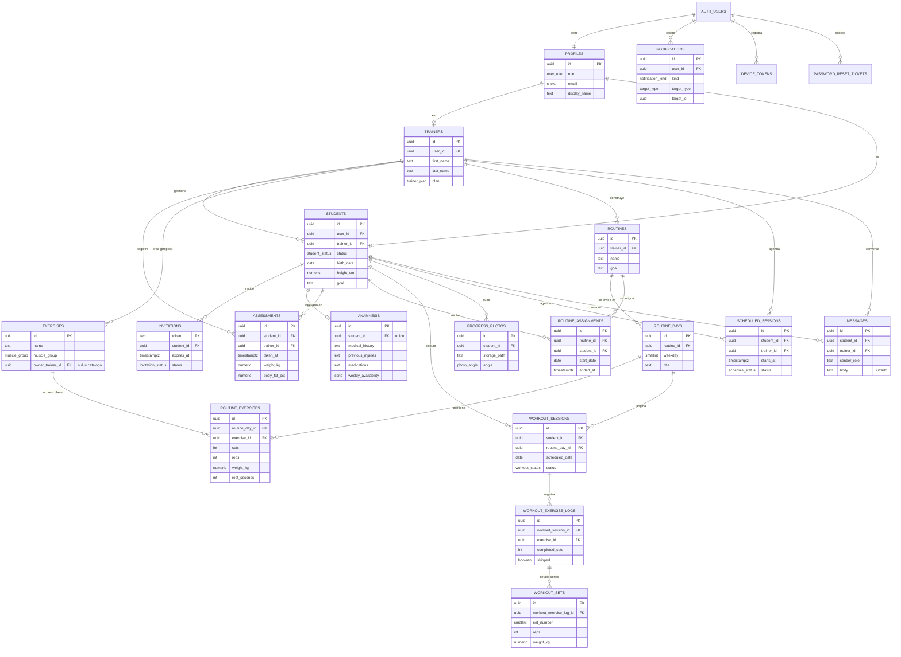

# Modelo de datos

Ñeque persiste sus datos en **PostgreSQL** administrado por **Supabase**. El esquema se
define con migraciones SQL versionadas en el repositorio de la aplicación
([`supabase/migrations/`](https://github.com/cosyfps/api-any-neque-mobile-app/tree/develop/supabase/migrations)):

| Migración                              | Contenido                                                   |
| -------------------------------------- | ----------------------------------------------------------- |
| `20261102000000_schema.sql`            | Enumeraciones, tablas, claves, índices y políticas RLS      |
| `20261102000100_functions.sql`         | Funciones transaccionales: `save_routine`, `set_routine_assignments`, `save_workout_session` |
| `20261102000200_storage.sql`           | Buckets de Storage para avatares y fotos de progreso        |
| `20261102000300_exercise_catalog.sql`  | Catálogo inicial de ejercicios                              |
| `20261103000000_active_session.sql`    | Sesión única por cuenta                                     |
| `20261104000000_routine_day_start_time.sql` | Hora de inicio por día de rutina                       |
| `20261104000100_messages.sql`          | Mensajes entre entrenador y alumno                          |
| `20261104000200_messages_encrypted.sql`| Cifrado del cuerpo de los mensajes                          |

En total: **21 tablas** y **16 enumeraciones**. Todas las claves primarias son UUID (salvo
tokens), los tiempos se guardan en UTC (`timestamptz`) y el borrado de rutinas, ejercicios y
fotos es lógico (`deleted_at`).

## Diagrama entidad-relación

> `login_attempts` (control de intentos de inicio de sesión) no tiene relaciones y se omite
> del diagrama.

## Entidades por área

| Área                | Tablas                                                                 |
| ------------------- | ---------------------------------------------------------------------- |
| Identidad y acceso  | `profiles`, `trainers`, `students`, `invitations`, `password_reset_tickets`, `login_attempts`, `device_tokens` |
| Ficha del alumno    | `anamnesis`, `assessments`, `progress_photos`                          |
| Rutinas             | `exercises`, `routines`, `routine_days`, `routine_exercises`, `routine_assignments` |
| Ejecución           | `workout_sessions`, `workout_exercise_logs`, `workout_sets`            |
| Agenda y contacto   | `scheduled_sessions`, `notifications`, `messages`                      |

## Reglas de negocio que garantiza la base

- Un alumno tiene **una sola rutina activa** a la vez (índice único parcial sobre
  `routine_assignments` sin `ended_at`); asignar una nueva archiva la anterior.
- Una rutina tiene **un solo día por día de la semana** (índice único `routine_id + weekday`).
- La anamnesis es **única por alumno** (`student_id unique`).
- La sesión ejecutada guarda una **copia de lo prescrito** (`workout_exercise_logs`): es un
  hecho histórico y no cambia si el entrenador edita la rutina después.
- Un alumno tiene **una sola invitación pendiente** y cada ejercicio ocupa una **posición
  única** dentro de su día.
- **Row Level Security** habilitado y cerrado en todas las tablas (`anon` y `authenticated`
  sin permisos): solo el BFF accede con la clave de servicio, resuelve el actor desde el JWT y
  filtra por entrenador o alumno.
- El cuerpo de los mensajes se guarda **cifrado** y lo descifra el BFF.

## Enumeraciones

`user_role`, `student_status`, `trainer_plan`, `invitation_status`, `muscle_group`,
`exercise_load`, `exercise_measure`, `workout_status`, `skip_reason`, `photo_angle`,
`session_kind`, `schedule_status`, `cancel_reason`, `notification_kind`, `target_type`,
`device_platform`.
