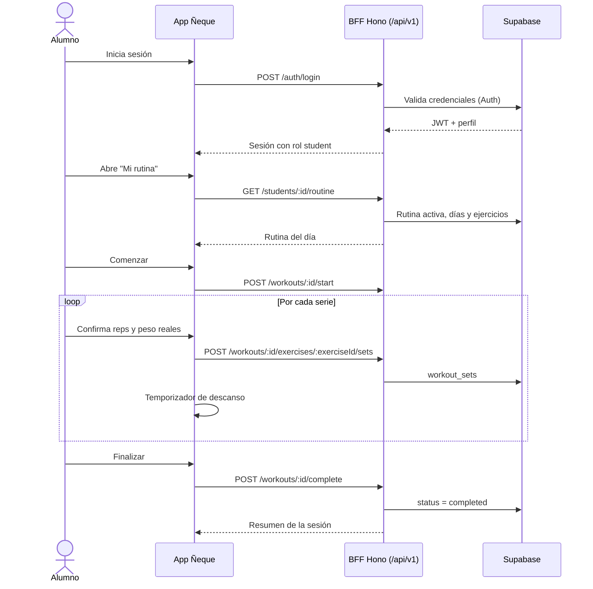
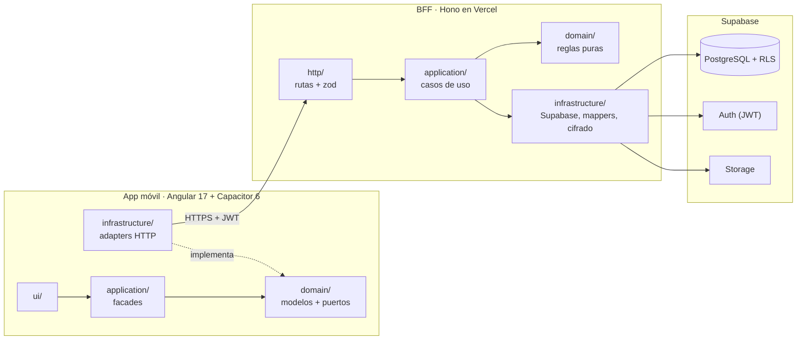
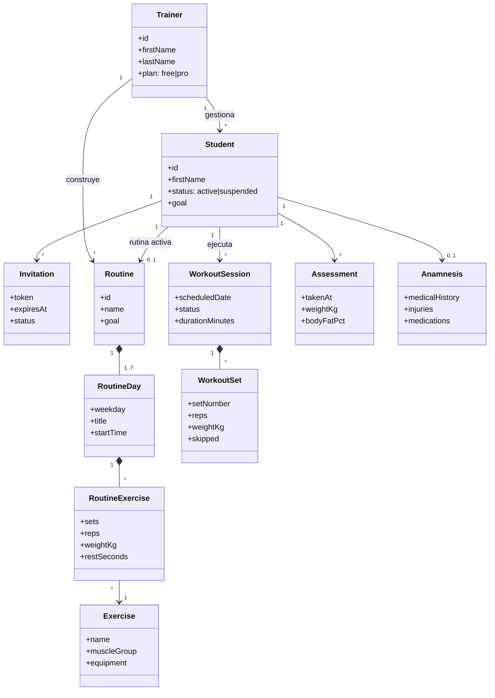

# Diagramas UML

Los diagramas UML representan la estructura y el comportamiento del sistema Ñeque. Cada
diagrama existe como fuente PlantUML (`.puml`) en esta carpeta y, para verlo directamente en
GitHub, también en Mermaid dentro de este documento.

| Diagrama                         | Fuente                                                         | Imagen                                                             |
| -------------------------------- | -------------------------------------------------------------- | ------------------------------------------------------------------ |
| Casos de uso                     | [`casos-de-uso.puml`](casos-de-uso.puml)                       | [`DIAGRAMA UML - CASOS DE USO.png`](DIAGRAMA%20UML%20-%20CASOS%20DE%20USO.png) |
| Secuencia: ejecutar entrenamiento | [`secuencia-entrenamiento.puml`](secuencia-entrenamiento.puml) | [`DIAGRAMA UML - FLUJO ENTRENAMIENTO.png`](DIAGRAMA%20UML%20-%20FLUJO%20ENTRENAMIENTO.png) |
| Componentes (arquitectura)       | [`componentes.puml`](componentes.puml)                         | Mermaid abajo                                                      |
| Clases del dominio               | Mermaid abajo                                                  | Mermaid abajo                                                      |

El modelo entidad-relación de la base de datos está en [`../modelo-datos.md`](../modelo-datos.md).

## 1. Casos de uso

Actores: **Entrenador** y **Alumno** (el **Administrador** da de alta entrenadores por script,
sin interfaz en el MVP).

| Entrenador                                         | Alumno                                                   |
| -------------------------------------------------- | -------------------------------------------------------- |
| Iniciar sesión y recuperar contraseña              | Aceptar invitación y crear contraseña                    |
| Registrar alumno e invitarlo por enlace o QR       | Ver la sesión del día y su rutina                        |
| Ver, buscar, editar, suspender y reactivar alumnos | Ejecutar el entrenamiento serie por serie                |
| Registrar anamnesis y evaluaciones físicas         | Registrar repeticiones y peso reales, o saltar ejercicio |
| Crear, duplicar y asignar rutinas                  | Mover un entrenamiento a otro día libre                  |
| Gestionar ejercicios propios                       | Ver progreso: peso, IMC, fotos y cargas                  |
| Agendar, reagendar y cancelar citas                | Ver agenda, confirmar o cancelar citas                   |
| Enviar mensajes al alumno                          | Enviar mensajes al entrenador y ver notificaciones       |

## 2. Secuencia: ejecución de un entrenamiento

## 3. Componentes

La regla de dependencias es la de la arquitectura hexagonal: `domain` no depende de nadie;
`application` solo de `domain`; `infrastructure` implementa los puertos de `domain`; `ui`
usa `application` y `domain`.

## 4. Clases del dominio

